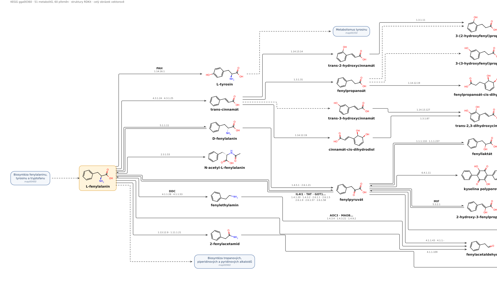

# KEGG_Pathway – metabolické dráhy z KEGG jako vektorové SVG se strukturami

Program vezme dráhu z databáze [KEGG](https://www.kegg.jp/kegg/pathway.html) (soubor KGML)
a nakreslí ji znovu, tentokrát se **strukturními vzorci** místo koleček. Výsledkem je čisté
**vektorové SVG**: struktury, šipky i veškerý text jsou křivky, takže obrázek zůstane ostrý
při libovolném zvětšení a dá se dál upravovat v Inkscapu, Illustratoru nebo Corelu.



Celá mapa: [priklady/gga00360_fenylalanin.svg](priklady/gga00360_fenylalanin.svg) ·
s vynechanými kroky: [priklady/gga00360_vynechane_kroky.svg](priklady/gga00360_vynechane_kroky.svg) ·
[náhled celé mapy (PNG)](docs/ukazka_celkem.png)

*English summary: draws any KEGG metabolic pathway (KGML file) as a clean, fully vector SVG
with chemical structures (RDKit), glycan SNFG symbols, orthogonal non-crossing arrows,
EC numbers / organism genes and links to neighbouring pathways. Includes a Tkinter GUI for
choosing which metabolites and reactions to draw; hidden intermediates are replaced by a
"steps omitted" box. UI and output are in Czech.*

---

## Co program umí

- **Strukturní vzorce** všech metabolitů (RDKit), všechny ve stejném měřítku, se zmenšenými
  atomovými symboly. Koenzym A se zkracuje na „CoA“ (dá se vypnout).
- **Glykany** (např. gangliosidy v dráze 00604) se kreslí standardními symboly
  [SNFG](https://www.ncbi.nlm.nih.gov/glycans/snfg.html) s popisky vazeb (β1-4, α2-3 …),
  nebo volitelně jako plné atomové vzorce.
- **Rozložení bez křížení:** vrstvový (Sugiyamův) algoritmus s minimalizací křížení,
  pravoúhlé šipky, každá s vlastní svislou „kolejí“, a popisky enzymů s kontrolou kolizí.
- **Tři rozložení:**
  - *řádkové* – zleva doprava,
  - *kompaktní* – dlouhá dráha se zalomí do více pásů (jako text na řádky), aby obrázek
    vyšel blízko čtverci; šipky přes zalomení vedou vlastními koridory bez křížení,
  - *kruhové* – cyklus po kružnici, ostatní větve paprskovitě ven.
- **Cyklus jako kruh uvnitř řádkového / kompaktního rozložení:** např. citrátový cyklus se
  nakreslí jako kruh a zbytek dráhy (glykolýza …) se k němu napojí v řádcích. Kruh se natočí
  tak, aby látky napojené zleva byly vlevo; malé postranní větve leží vně kruhu u své látky.
  Program najde všechny cykly v dráze a v okně si vybereš, který má být kruhem.
- **Náhled přímo v okně** se zvětšováním a posouváním, bez ukládání souboru.
- **Přenašeče a enzymové komplexy:** thiamindifosfát, lipoyllysin, NAD apod. se ve výchozím
  stavu nekreslí. Meziprodukty vázané na enzymový komplex (např. u pyruvátdehydrogenázy
  a 2-oxoglutarátdehydrogenázy) se sloučí do jedné šipky se všemi enzymy komplexu,
  jak je to zvykem v učebnicích. V okně je lze zapnout.
- **Správný směr šipek:** nevratné reakce mají plný hrot (→), vratné dvojici polovičních (⇌).
  Reakce bez známého enzymu jsou čárkovaně.
- **Enzymy:** u šipek jsou EC čísla a názvy genů organismu z KGML (např. kuře `gga`, člověk `hsa`).
  Volitelně se enzymy organismu zvýrazní zeleně.
- **Navazující dráhy** jako zaoblené rámečky (citrátový cyklus, metabolismus tyrosinu …).
- **Okno s výběrem:** zaškrtneš, které metabolity a reakce chceš. Když vypneš metabolit
  uprostřed dráhy, nahradí ho fialový rámeček **„⋯ vynechány 2 metabolity: …“**
  s tečkovanými šipkami, takže je vidět, že kroky chybí.
- **Vlastní vzhled** (karta *Vzhled*): předvolby *Klasický, Barevný, Černobílý (tisk), Tmavý*,
  barva každého prvku (šipky, názvy, enzymy, vazby, pozadí, rámečky …), barevné nebo černé
  atomy, tvar hrotu (plný / trojúhelník / otevřený), tloušťka šipek, zaoblení rohů
  a rámečků, velikost struktur a písma, rozestupy a písmo. Nastavení se dá uložit jako výchozí.
- Export do **SVG**, volitelně **PDF/PNG** (přes `rsvg-convert` nebo `cairosvg`)
  a **EMF** (Windows metafile, přes Inkscape).

## Stažení pro Windows (.exe, bez instalace Pythonu)

Hotová aplikace `KEGG_Pathway.exe` se sestavuje automaticky (GitHub Actions):

- **Vydání (Releases)** – vpravo na stránce repozitáře → *Releases* → stáhni `KEGG_Pathway.exe`.
- **Nejnovější verze** – záložka *Actions* → poslední úspěšný běh „Sestavit Windows .exe“ →
  dole *Artifacts* → `KEGG_Pathway-windows` (zip s .exe; vyžaduje přihlášení na GitHub).

Stačí `.exe` spustit dvojklikem. První spuštění trvá déle (rozbaluje se, cca 10–20 s).
Mezipaměť `kegg_cache/` a uložené nastavení vzhledu se ukládají vedle `.exe`.
Windows SmartScreen může u neznámé aplikace zobrazit varování – *Další informace → Přesto spustit*.

## Instalace (spuštění ze zdrojového kódu)

Potřebuješ Python 3.9 nebo novější.

```bash
git clone https://github.com/Zacker452/KEGG_Pathway.git
cd KEGG_Pathway
pip install -r requirements.txt
```

Tkinter (okno aplikace) je součástí Pythonu na Windows a macOS. Na Linuxu ho případně
doinstaluj (`sudo apt install python3-tk`).

## Kde vzít KGML soubor

1. Otevři dráhu v KEGG, např. <https://www.kegg.jp/pathway/gga00360> (fenylalanin u kuřete).
   Kód organismu (`gga`, `hsa`, `mmu`, `eco` …) i číslo dráhy můžeš změnit přímo v adrese.
2. Klikni na **Download KGML** a soubor ulož (např. do složky Stažené soubory).

Pro dráhu **00360 (fenylalanin)** má program data vestavěná, takže funguje i bez KGML
a bez internetu. Jen pak nezná geny organismu.

## Použití

### Okno aplikace

```bash
python kegg_draha_svg.py
```

(V PyCharmu stačí soubor spustit zeleným ▷.)


1. **Otevřít…** – vyber KGML soubor. Program sám hledá i ve složce Stažené soubory.
2. Karta **Metabolity** – klikem na řádek látku zapneš nebo vypneš (☑/☐).
   Ctrl/Shift + klik označí více řádků, mezerník je pak přepne najednou.
3. Karta **Reakce** – vypnutá reakce se nekreslí. **Otočit směr označených**
   obrátí šipku (KGML občas uvádí nevratnou reakci obráceně).
4. Vpravo nastav vzhled. Tlačítko **Náhled** vykreslí obrázek na kartu Náhled (zvětšení
   „přizpůsobit šířce“ až 200 %, posun tažením myší). Když se ti líbí, ulož ho tlačítkem
   **Vytvořit SVG…**.

### Příkazová řádka

```bash
python kegg_draha_svg.py gga00360.xml                       # celá dráha -> gga00360_draha.svg
python kegg_draha_svg.py gga00360.xml --vynechat C00601,C07086 --pdf
python kegg_draha_svg.py hsa00010.xml --jen-organismus --zvyraznit
python kegg_draha_svg.py hsa00020.xml --kruh                # citrátový cyklus do kruhu
python kegg_draha_svg.py --podporovane                      # které dráhy program umí
python kegg_draha_svg.py --help                             # všechny volby
```

## Nastavení

| V okně | Na příkazové řádce | Co dělá |
|---|---|---|
| Výchozí metabolit | `--start C00079` | látka úplně vlevo, od ní se dráha rozkládá |
| Název pod / vedle struktury | `--popisky pod\|vpravo` | umístění názvu metabolitu |
| Rozložení: řádkové / kompaktní / kruhové | `--kompaktni`, `--kruh` | kompaktní = zalomení do pásů blízko čtverci |
| cyklus jako kruh (řádkové / kompaktní) | `--cyklus-kruh` | cyklus jako kruh, zbytek dráhy v řádcích |
| Cyklus: (výběr z nalezených cyklů) | `--cyklus C00036,C00158,…` | který cyklus má být kruhem (jinak nejdelší) |
| navazující dráhy | `--bez-odkazu` | rámečky s odkazy na další dráhy KEGG |
| názvy genů organismu | `--bez-genu` | geny z KGML u šipek |
| zvýraznit enzymy organismu zeleně | `--zvyraznit` | jako zelené boxy v KEGG |
| šipky přes vynechané kroky | – | rámeček „⋯ vynechány N metabolity“ místo skrytých látek |
| glykany jako atomové vzorce | `--glykany-atomy` | místo symbolů SNFG plná struktura |
| přenašeče a vázané meziprodukty (karta Metabolity, ve výchozím stavu vypnuté) | `--s-kofaktory` | ThPP, lipoyllysin …; vypnuté = komplex jako jedna šipka |
| zkracovat koenzym A na „CoA“ | `--plne-coa` (vypne) | celý CoA má 48 atomů, se zkratkou je struktura přehlednější |
| Vzhled → Velikost struktur | `--delka-vazby 20` | délka vazby v px (12–40) |
| Vzhled → Písmo atomů | `--velikost-atomu 0.5` | relativní velikost symbolů C, O, N … |
| Vlastní nadpis | `--nadpis "…"` | jinak se použije název dráhy |
| karta Vzhled → Předvolba | `--predvolba "Tmavý"` | Klasický, Barevný, Černobílý (tisk), Tmavý |
| karta Vzhled → Uložit jako výchozí | `--vzhled soubor.json` | uložené barvy, tvary a velikosti (`nastaveni_vzhledu.json`) |
| Jen reakce organismu | `--jen-organismus` | jen reakce, pro které má organismus gen |
| Náhled (karta Náhled) | – | vykreslí obrázek v okně, nic neukládá |
| navíc PDF | `--pdf`, `--png`, `--emf` | další formáty |
| stahovat z KEGG | `--offline` (vypne) | bez internetu se použije jen mezipaměť |

Výchozí hodnoty vzhledu a předvolby jsou ve skriptu v `VYCHOZI_VZHLED` a `PREDVOLBY`
(sekce `VZHLED`) – vlastní předvolbu lze přidat jedním řádkem.

## Které dráhy jsou podporované

| Typ dráhy | Podpora |
|---|---|
| Metabolické dráhy **00xxx** (glykolýza 00010, citrátový cyklus 00020, puriny 00230, aminokyseliny …) | ✔ |
| Libovolný organismus (`gga`, `hsa`, `mmu`, `eco` …) i referenční mapy (`map`, `ko`) | ✔ |
| Glykanové dráhy (00510, 00604 …) – symboly SNFG | ✔ |
| Cyklické dráhy (00020 citrátový cyklus, močovinový cyklus …) – kruh, i napojený na zbytek dráhy | ✔ |
| Signální a regulační dráhy **04xxx**, dráhy nemocí **05xxx** | ✘ – v KGML nejsou reakce mezi látkami, jen vztahy proteinů (program to oznámí) |
| Přehledové mapy **01100, 01200** … | ✘ – příliš velké, bez popsaných reakcí |

**Na co si dát pozor**

- Kruhové rozložení bere nejdelší cyklus ve vybrané části dráhy (přenašeče se do něj
  nepočítají). Pokud chceš jiný cyklus,
  vypni látky, které do něj nepatří (nahradí je rámeček „vynechané kroky“).
- Látky bez struktury v KEGG (protein, akceptor, polymery) mají jen rámeček s názvem.
- Uzlové metabolity (pyruvát, acetyl-CoA), které KEGG kreslí na více místech, jsou v obrázku
  jednou. Vede z nich proto víc šipek.
- U map nad 120 látek program upozorní. Doporučuji vypnout části, které nepotřebuješ.
- České názvy látek jsou vestavěné pro dráhu 00360. U ostatních drah se použijí anglické
  názvy z KEGG (vlastní překlady lze doplnit do tabulky `CESKE_NAZVY`).

## Jak to funguje

1. **Načtení dat.** Z KGML se vezmou reakce a geny organismu. U map organismu (např. `gga`)
   se z KEGG REST API stáhne referenční mapa `ko<číslo>` se všemi reakcemi a k ní EC čísla,
   názvy a struktury (MOL, u glykanů strom cukrů KCF). Vše se ukládá do složky `kegg_cache/`,
   takže podruhé to funguje i offline.
2. **Výběr.** Vybrané látky a reakce se sloučí podle dvojic látek (paralelní enzymy
   = jedna šipka). Skryté látky mezi vybranými se nahradí rámečkem „vynechané kroky“.
3. **Rozložení.** Vrstvy podle vzdálenosti od výchozí látky, pomocné uzly pro dlouhé hrany,
   barycentrická metoda s výměnami sousedů (minimalizace křížení) a svislé polohy
   izotonickou regresí (PAV). Kruhové rozložení: nejdelší orientovaný cyklus (prohledávání
   do hloubky) po kružnici, šipky po obvodu jako oblouky (Bézierovy křivky), větve jako
   strom do výsečí kolem kružnice.
4. **Šipky.** Pravoúhlé vedení, pořadí svislých kolejí v každé mezeře optimalizované
   proti křížení, popisky s kontrolou kolizí.
5. **Výstup.** Struktury z RDKit (text atomů jako křivky), ostatní text převedený na obrysy
   přes matplotlib `TextPath`. V SVG není žádný `<text>`. Náhled v okně vykresluje stejné
   SVG přes matplotlib (Agg), takže nepotřebuje žádnou další knihovnu.

## Data KEGG a licence

Program pracuje s daty KEGG, která si každý uživatel stahuje sám (KGML soubory a
[KEGG REST API](https://www.kegg.jp/kegg/rest/keggapi.html)). KEGG je zdarma pro akademické
použití. Komerční použití a hromadné šíření dat KEGG podléhá
[licenčním podmínkám KEGG](https://www.kegg.jp/kegg/legal.html). Repozitář proto
neobsahuje soubory KGML ani mezipaměť `kegg_cache/`.

Symboly glykanů podle SNFG: Varki A. et al., *Glycobiology* 25, 1323–1324 (2015).
